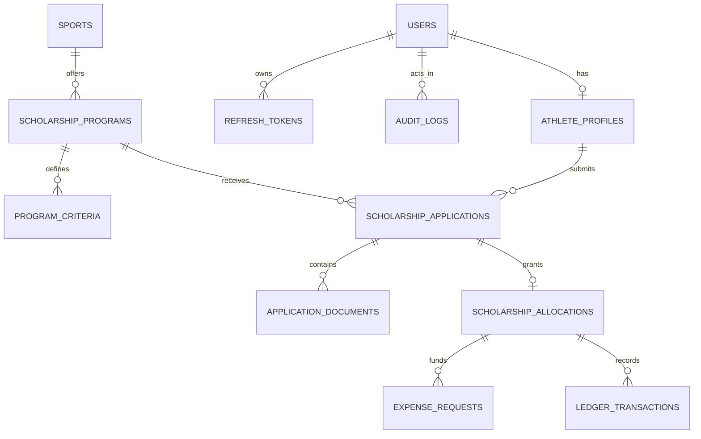

# Database Architecture and Schema Specification

**Platform:** Bharat Sports Grant (Sportsbridge India)  
**Database Engine:** PostgreSQL 16+  
**ORM:** SQLAlchemy 2.0 (Async)  
**Migration Tool:** Alembic  

---

## 1. Relational Entity-Relationship Diagram

---

## 2. Core Tables and Schema Definitions

### 2.1 `users`
Authentication credentials and role identity.
- `id` (UUID, Primary Key, default `gen_random_uuid()`)
- `email` (VARCHAR(255), Unique, Indexed, Not Null)
- `phone` (VARCHAR(15), Unique, Indexed, Not Null) — Normalized E.164 (+91XXXXXXXXXX)
- `password_hash` (VARCHAR(255), Not Null) — Argon2id / bcrypt
- `role` (VARCHAR(50), Not Null, default `'ATHLETE'`) — `ATHLETE`, `VERIFIER`, `ADMIN`, `FINANCE`, `SUPERADMIN`
- `is_email_verified` (BOOLEAN, default FALSE)
- `is_phone_verified` (BOOLEAN, default FALSE)
- `is_active` (BOOLEAN, default TRUE)
- `created_at` (TIMESTAMPTZ, default `NOW()`)
- `updated_at` (TIMESTAMPTZ, default `NOW()`)

### 2.2 `athlete_profiles`
Detailed athlete background information.
- `id` (UUID, Primary Key)
- `user_id` (UUID, Foreign Key `users.id`, Unique, Not Null)
- `first_name` (VARCHAR(100), Not Null)
- `last_name` (VARCHAR(100), Not Null)
- `username` (VARCHAR(50), Unique, Indexed, Not Null)
- `date_of_birth` (DATE, Not Null)
- `gender` (VARCHAR(20), Nullable)
- `height_cm` (NUMERIC(5, 2), Nullable)
- `weight_kg` (NUMERIC(5, 2), Nullable)
- `state` (VARCHAR(100), Not Null)
- `city` (VARCHAR(100), Not Null)
- `education_level` (VARCHAR(50), Not Null)
- `sports_interests` (JSONB, default `'[]'`)
- `created_at` (TIMESTAMPTZ, default `NOW()`)
- `updated_at` (TIMESTAMPTZ, default `NOW()`)

### 2.3 `sports` & `scholarship_programs`
Sports directory and configurable scholarship schemes.
- **`sports`**: `id`, `code` (e.g. `'CRICKET'`, `'ARCHERY'`), `name`, `description`, `is_active`, `icon_url`.
- **`scholarship_programs`**: `id`, `sport_id` (FK `sports.id`), `name`, `code`, `description`, `funding_min` (NUMERIC(14, 2)), `funding_max` (NUMERIC(14, 2)), `application_start`, `application_end`, `is_active`, `version` (INT, default 1).

### 2.4 `scholarship_applications`
Applicant submissions and verification status.
- `id` (UUID, Primary Key)
- `reference_number` (VARCHAR(30), Unique, Indexed) — e.g., `BSG-2026-CRIC-0084`
- `athlete_id` (UUID, Foreign Key `athlete_profiles.id`, Not Null)
- `program_id` (UUID, Foreign Key `scholarship_programs.id`, Not Null)
- `status` (VARCHAR(50), Not Null) — `DRAFT`, `SUBMITTED`, `PRELIMINARY_REVIEW`, `VERIFICATION_PENDING`, `APPROVED`, `REJECTED`, `APPEALED`
- `preliminary_score` (NUMERIC(5, 2), Nullable)
- `assigned_verifier_id` (UUID, FK `users.id`, Nullable)
- `decision_date` (TIMESTAMPTZ, Nullable)
- `created_at` (TIMESTAMPTZ, default `NOW()`)
- `updated_at` (TIMESTAMPTZ, default `NOW()`)

### 2.5 Financial Ledger Entities
- **`scholarship_allocations`**:
  - `id` (UUID, Primary Key)
  - `application_id` (UUID, Unique, FK `scholarship_applications.id`)
  - `athlete_id` (UUID, FK `athlete_profiles.id`)
  - `total_approved_amount` (NUMERIC(14, 2), Not Null)
  - `created_at` (TIMESTAMPTZ, default `NOW()`)
- **`expense_requests`**:
  - `id` (UUID, Primary Key)
  - `allocation_id` (UUID, FK `scholarship_allocations.id`)
  - `category` (VARCHAR(50)) — `COACHING`, `EQUIPMENT`, `TRAVEL`, `ACCOMMODATION`, `REGISTRATION`
  - `amount` (NUMERIC(14, 2), Not Null)
  - `purpose` (TEXT, Not Null)
  - `status` (VARCHAR(50)) — `SUBMITTED`, `VERIFIED`, `APPROVED`, `DISBURSED`, `REJECTED`
  - `disbursed_at` (TIMESTAMPTZ, Nullable)
- **`ledger_transactions`**:
  - `id` (UUID, Primary Key)
  - `allocation_id` (UUID, FK `scholarship_allocations.id`)
  - `expense_request_id` (UUID, FK `expense_requests.id`, Nullable)
  - `transaction_type` (VARCHAR(50)) — `ALLOCATION_CREDIT`, `EXPENSE_RESERVATION`, `DISBURSEMENT_RELEASE`, `RESERVATION_CANCELLED`, `ADJUSTMENT`
  - `amount` (NUMERIC(14, 2), Not Null)
  - `running_available_balance` (NUMERIC(14, 2), Not Null)
  - `idempotency_key` (VARCHAR(100), Unique, Not Null)
  - `created_at` (TIMESTAMPTZ, default `NOW()`)

### 2.6 `audit_logs`
Immutable compliance and activity record.
- `id` (UUID, Primary Key)
- `actor_id` (UUID, FK `users.id`, Nullable)
- `action` (VARCHAR(100), Not Null)
- `entity_type` (VARCHAR(50), Not Null)
- `entity_id` (VARCHAR(100), Not Null)
- `before_state` (JSONB, Nullable)
- `after_state` (JSONB, Nullable)
- `ip_address` (VARCHAR(45), Nullable)
- `created_at` (TIMESTAMPTZ, default `NOW()`)
